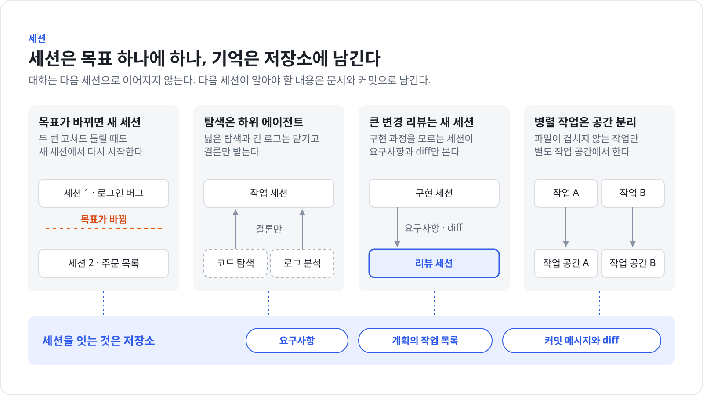

# AI 작업 지침

이 저장소에서 일하는 AI 코딩 에이전트가 따르는 규칙이다. 사람도 이 규칙을 기준으로 AI의 작업을 검토한다.

Monitoring Manager는 Prometheus 기반 모니터링을 웹 화면에서 관리하는 도구다. 운영자는 YAML이나 PromQL을 직접 고치지 않고 가용성 Check, 서버 SNMP Resource, Telegram 알림을 화면에서 설정한다.

## 먼저 읽을 문서

작업과 관련된 문서만 읽는다.

| 알고 싶은 것 | 문서 |
|---|---|
| 프로젝트 목적과 시작 방법 | [README.md](README.md) |
| 시스템 구조, 코드 위치, 지켜야 할 경계 | [docs/ARCHITECTURE.md](docs/ARCHITECTURE.md) |
| Check, SNMP, 알림의 상세 동작과 운영 절차 | `docs/architecture/` |
| 개발 환경, 명령, 커밋과 반영 절차 | [docs/DEVELOPMENT.md](docs/DEVELOPMENT.md) |
| 테스트 종류와 작성 기준 | [docs/TESTING.md](docs/TESTING.md) |
| 문서와 그림 작성 규칙 | [docs/WRITING.md](docs/WRITING.md) |
| 화면 설계 원칙 | [docs/DESIGN.md](docs/DESIGN.md) |
| 기능별 요구사항과 계획 | `docs/requirements/` |
| 되돌리기 어려운 결정과 이유 | `docs/decisions/` |

## 자주 쓰는 명령

```sh
cd frontend && npm ci
scripts/verify fast
scripts/verify all
node scripts/check-docs.mjs
```

`scripts/verify`는 Bash 스크립트다. Backend 검사에는 JDK 21이, `all`에는 Docker가 필요하다. 전체 명령은 [DEVELOPMENT.md의 명령](docs/DEVELOPMENT.md#명령)에 있다. 명령이 바뀌면 두 곳을 함께 고친다.

## 작업 흐름


작업을 시작할 때 변경 규모를 정하고, 보고할 때 밝힌다. 판단이 애매하면 더 큰 쪽을 고른다.

| 규모 | 기준 | 남기는 문서 | 사람이 결정하는 지점 |
|---|---|---|---|
| 작은 변경 | 한 문장으로 설명된다. 동작이 바뀌지 않거나 원인이 명확한 버그다 | 없음 | 공유 반영 전 리뷰 |
| 보통 변경 | 사용자가 겪는 동작이 바뀌거나 기능이 늘어난다. 구현 방법은 분명하다 | 요구사항 | 요구사항 승인, 공유 반영 전 리뷰 |
| 큰 변경 | 위험 영역을 건드리거나, 여러 모듈에 걸치거나, 구현 방법을 골라야 한다 | 요구사항, 계획, 필요하면 ADR | 요구사항 승인, 계획 승인, 공유 반영 전 리뷰 |

**위험 영역**은 데이터베이스 스키마, 공개 API 계약, 인증·권한, 개인정보, 배포·인프라, 빌드 설정, 런타임 의존성, CI 설정이다. 위험 영역을 건드리는 변경은 크기와 관계없이 큰 변경으로 다룬다. 공개 API는 다른 팀, 다른 저장소, 외부 고객이 호출하는 API다. 같은 저장소의 화면만 쓰는 API에 엔드포인트를 더하는 것은 위험 영역이 아니다. 기존 응답을 바꾸거나 지우는 것은 위험 영역이다.

이 저장소에서는 다음도 위험 영역이다.

- Flyway migration(`backend/src/main/resources/db/migration/`)
- Prometheus가 호출하는 HTTP SD 응답과 Alertmanager webhook 계약
- `compose.yml`과 `infrastructure/`의 Prometheus·Alertmanager·Blackbox·SNMP 설정
- DB 비밀번호, SNMP community, Telegram Bot Token, `APP_SECRET_KEY`를 저장·전달·기록하는 방식

사람이 문서나 승인 단계를 생략하라고 분명히 말하면 따른다. 생략한 단계는 보고에 적는다.

### 단계별 규칙

1. **이해**: 관련 코드와 문서를 먼저 읽는다. 코드로 확인하지 않은 내용은 추측이라고 밝힌다.
2. **요구사항**: [요구사항 템플릿](docs/templates/requirement.md)으로 `docs/requirements/NNNN-짧은-이름.md`를 만든다. 정하지 못한 점은 `확인 필요`에 적고 사람에게 묻는다. 승인 전에는 구현하지 않는다.
3. **계획**: 큰 변경에서만 [계획 템플릿](docs/templates/plan.md)으로 `docs/requirements/NNNN-짧은-이름.plan.md`를 만든다. 되돌리기 어려운 결정은 [ADR 템플릿](docs/templates/decision.md)으로 `docs/decisions/`에 남긴다.
4. **구현**: 요구사항 범위 안에서만 고친다. 범위 밖 문제를 발견하면 고치지 않고 보고에 적는다.
5. **테스트**: [TESTING.md](docs/TESTING.md) 기준으로 필요한 테스트를 쓰고 실행한다. 테스트를 지우거나 느슨하게 바꿔서 통과시키지 않는다.
6. **자체 리뷰**: 아래 체크리스트로 diff 전체를 확인한다. 큰 변경은 구현하지 않은 새 세션에 요구사항과 diff만 주고 리뷰를 맡긴다.
7. **보고**: 아래 형식으로 대화에서 보고한다. 보고서 파일은 만들지 않는다.
8. **기록**: [커밋 규칙](docs/DEVELOPMENT.md#커밋)에 맞춰 변경을 기록한다. Git은 로컬 커밋을 만든다. 사람이 기록하지 말라고 하면 하지 않는다.
9. **공유 반영**: push, PR이나 리뷰 요청 생성, merge, 배포는 사람이 지시할 때만 한다. 반영 직전에 검증 명령을 다시 실행한다.

## 자체 리뷰 체크리스트

- 요구사항의 완료 기준을 하나씩 확인했다.
- diff에 의도하지 않은 변경이 없다. 예: 관련 없는 서식 변경, 디버그 출력, 주석 처리한 코드.
- `git status`에 예상하지 않은 파일이 없다.
- 위험 영역을 건드렸다면 보고에 따로 적었다.
- 바뀐 동작에 맞춰 문서를 고쳤다.
- 비밀값, 개인정보, 개인 PC 경로가 들어가지 않았다.
- 문서나 그림을 바꿨다면 `node scripts/check-docs.mjs`가 통과한다. 그림을 바꿨다면 `--render`로 렌더링 결과를 직접 확인했다.

## 결과 보고

작은 변경은 세 줄 안팎으로 짧게 쓴다. 해당 없는 항목은 뺀다.

```text
규모: 작은 변경 / 보통 변경 / 큰 변경
변경: 무엇을 바꿨는가
이유: 왜 바꿨는가
검증: 실행한 명령과 결과
확인하지 못한 것: 실행하지 못한 검증, 남은 위험, 범위 밖에서 발견한 문제
리뷰할 곳: 사람이 먼저 볼 파일과 이유
```

## 세션



- 하나의 목표는 하나의 세션에서 끝낸다. 목표가 바뀌면 새 세션을 연다.
- 같은 문제를 두 번 고쳤는데도 틀리면 멈춘다. 알게 된 사실을 정리해 새 세션에서 다시 시작한다.
- 넓은 코드 탐색과 긴 로그 분석은 하위 에이전트에 맡기고 결론만 받는다.
- 서로 다른 파일을 고치는 독립 작업만 동시에 맡긴다. 병렬 작업은 각각 별도 Git worktree에서 한다.
- 큰 변경의 리뷰는 구현한 세션이 아닌 새 세션이 맡는다.
- 다음 세션이 알아야 할 내용은 대화가 아니라 저장소에 남긴다. 요구사항, 계획의 작업 목록, 커밋 메시지가 그 역할을 한다.

## 새 파일

- 요청이나 이 지침에 없는 파일은 만들지 않는다. 보고서, 요약, 메모, 세션 기록, 임시 스크린샷, 디버그 스크립트가 대표적이다.
- 임시 파일은 저장소 밖 OS 임시 폴더에 만든다.
- 새 문서가 필요해 보이면 기존 문서에 넣을 자리부터 찾는다. 그래도 새 문서를 만든다면 이유를 보고한다.
- 작업을 끝내기 전에 `git status`로 새로 생긴 파일, 고친 파일, 지운 파일을 확인한다.

## 문서

- 문서와 그림은 [WRITING.md](docs/WRITING.md) 규칙을 따른다.
- 코드 동작을 바꾸면 같은 변경에서 관련 문서도 고친다.
- 계획 문서는 작업을 마치면 지운다. 오래 남길 결정은 ADR로 옮긴다.
- 하위 디렉터리에 `AGENTS.md`가 있으면 그 디렉터리 안에서는 그 지침이 우선한다. 하위 `AGENTS.md`를 만들 때는 같은 위치에 `@AGENTS.md` 한 줄만 담은 `CLAUDE.md`도 만든다.

## 프로젝트 고유 규칙

- 사용자가 화면에서 바꾼 설정 때문에 `infrastructure/`의 설정 파일과 Alert 규칙을 만들거나 고치지 않는다. 사용자 설정의 기준은 Manager Database다. 자세한 경계는 [ARCHITECTURE.md의 지켜야 할 경계](docs/ARCHITECTURE.md#지켜야-할-경계)에 있다.
- Flyway migration은 `mariadb`와 `postgresql` 디렉터리에 같은 version으로 함께 추가한다. 이미 적용된 migration 파일은 고치지 않는다.
- HTTP SD 응답의 label을 더하거나 지우거나 이름을 바꾸면 Prometheus time series가 끊긴다. 바꾸기 전에 사람에게 확인한다.
- 코드·설정 주석의 `(CLAUDE.md N번)`은 옛 지침의 규칙 번호이고, 그 원문은 저장소에 없다. 새 주석에 이 표기를 쓰지 않는다. 규칙은 ARCHITECTURE.md의 지켜야 할 경계로 확인한다.
- 실제 Telegram 그룹이나 운영 Check로 알림 경로를 시험하지 않는다. 방법은 [notifications.md의 알림 경로 확인](docs/architecture/notifications.md#알림-경로-확인)에 있다.
