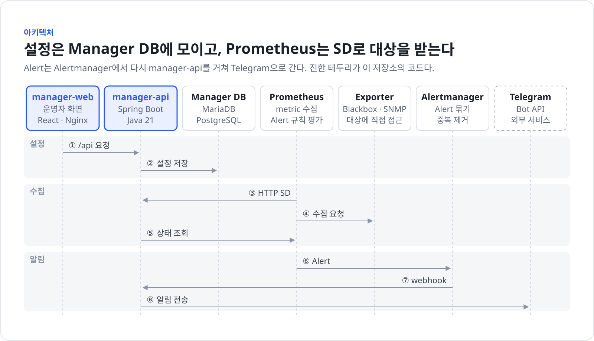

# 아키텍처

이 시스템이 어떤 부분으로 나뉘고, 각 부분이 어디에 있으며, 어떤 경계를 지켜야 하는지 설명한다. 처음 코드를 고치는 사람이 "이 기능은 어디를 고쳐야 하는가"를 빨리 찾게 하는 것이 목적이다.

## 한눈에 보기

Monitoring Manager는 사용자가 화면에서 등록한 Check와 서버를 Manager Database에 저장한다. Prometheus는 HTTP SD로 그 목록을 가져가 Blackbox Exporter와 snmp_exporter로 수집하고, Alertmanager가 보낸 Alert는 Manager가 받아 기록한 뒤 Telegram 그룹으로 보낸다. 사용자 설정의 기준은 Manager Database이고, `infrastructure/`의 설정 파일은 배포할 때만 바뀐다.

## 실행 단위

따로 실행되거나 배포되는 단위와 그 기술, 통신 방식은 다음과 같다. 모두 `compose.yml`에 있고 `monitoring` 네트워크 하나를 쓴다. 호스트에 여는 포트는 모두 `127.0.0.1`에만 묶는다.

| 단위 | 역할 | 기술 | 통신 |
|---|---|---|---|
| `manager-web` | 사용자 화면과 `/api/` 프록시 | React, Vite, Nginx | 브라우저에서 HTTP(호스트 8081), `/api/` 프록시 |
| `manager-api` | 설정 관리, HTTP SD 목록 제공, Alert 수신과 Telegram 전송 | Spring Boot, Java 21 | REST(호스트 8080), JDBC, Prometheus HTTP API, Telegram Bot API, SNMP |
| Manager Database | Manager의 설정과 Alert·전송 기록 저장 | MariaDB 또는 PostgreSQL | JDBC |
| `prometheus` | HTTP SD로 대상을 받아 수집하고 Alert 규칙을 평가 | Prometheus | `manager-api`의 HTTP SD 호출, exporter 수집, Alertmanager로 Alert 전송 |
| `alertmanager` | Alert를 묶어 `manager-api` webhook 하나로 보냄 | Alertmanager | Bearer token을 붙인 webhook |
| `blackbox-exporter` | ICMP, TCP, HTTP, HTTPS 가용성 확인 | Blackbox Exporter | Prometheus가 probe 요청 |
| `snmp-exporter` | 서버의 CPU, Memory, Storage를 SNMP로 수집 | snmp_exporter | Prometheus가 수집 요청 |
| `snmp-test-agent` | 개발 환경에서 SNMP 흐름을 확인하는 테스트 장비 | snmpd | `snmp-test` profile에서만 뜬다 |

표에 다 적지 못한 내용은 다음과 같다.

- 개발용 Manager Database는 `local-db` profile의 `manager-db`(MariaDB)다. 운영에서는 외부 MariaDB나 PostgreSQL을 쓴다.
- `snmp-exporter`는 `manager-api`가 `snmp-runtime` volume에 쓴 auth 파일을 읽는다.

외부 시스템은 다음과 같다.

- **Telegram**: `manager-api`가 Bot API로 알림을 보낸다. 그룹의 `/register` 명령은 Telegram이 `manager-api`의 webhook으로 보낸다. 이 webhook은 외부에서 접근 가능한 HTTPS 주소(`TELEGRAM_WEBHOOK_PUBLIC_URL`)가 있을 때만 쓴다.
- **감시 대상**: 사용자가 등록한 서버와 서비스다. exporter가 수집하고, `manager-api`도 SNMP 연결 시험과 Resource 탐색에서 직접 SNMP로 묻는다.
- **Grafana**: `compose.yml`에 없다. `manager-api`는 화면에 보일 링크 주소(`GRAFANA_URL`)만 내려준다.

## API와 데이터 모델

API 명세와 데이터 모델의 원본 위치는 다음과 같다.

- API 명세: 없다. 컨트롤러 코드(`*Controller`)가 기준이다. 오류는 `ApiExceptionHandler`가 ProblemDetail 형식으로 돌려준다.
- 데이터 모델: JPA Entity와 Flyway migration `backend/src/main/resources/db/migration/mariadb/`, `backend/src/main/resources/db/migration/postgresql/`. Hibernate는 schema를 만들지 않고 Entity와 맞는지만 확인한다(`ddl-auto: validate`).

## 코드 지도

디렉터리와 주요 모듈의 책임은 다음과 같다.

| 위치 | 책임 |
|---|---|
| `backend/` 패키지 `alert` | Alertmanager webhook을 받아 Alert를 기록한다 |
| `backend/` 패키지 `check` | Blackbox 기반 가용성 Check(ICMP, TCP, HTTP, HTTPS)와 확인 대상 |
| `backend/` 패키지 `server` | 사용자가 등록한 서버 자산 |
| `backend/` 패키지 `snmp` | 서버별 SNMP 설정, 직접 SNMP 조회, snmp_exporter auth 파일 동기화와 reload |
| `backend/` 패키지 `resource` | 서버에서 발견한 Resource와 사용자가 고른 감시 Resource |
| `backend/` 패키지 `prometheus` | HTTP SD 목록과 PromQL 조회 |
| `backend/` 패키지 `notification` | Alert를 Telegram 메시지로 만들어 보내고 결과를 기록한다 |
| `backend/` 패키지 `common` | 오류 응답(`exception`)과 DB에 저장하는 인증 정보의 암호화(`security`) |
| `backend/` 패키지 `config` | 환경 변수 바인딩, bean 등록, 비밀값 읽기(`ManagerSecrets`) |
| `backend/` 패키지 `system` | 화면에 필요한 시스템 정보 |
| `backend/` 패키지 `threshold`, `grafana`, `database` | 아직 구현하지 않은 자리(`package-info.java`만 있음) |
| `frontend/src/pages` | 라우트마다 하나인 화면 |
| `frontend/src/components` | 앱 공통 컴포넌트와 도메인별(`checks`, `servers`, `notifications`) 폼과 섹션 |
| `frontend/src/components/ui` | 버튼, 다이얼로그, 입력, 표 같은 기본 UI |
| `frontend/src/lib` | API 호출과 query 정의(`api.ts`), 표시 형식(`format.ts`) |
| `infrastructure/` | Prometheus, Alertmanager, Blackbox, SNMP 테스트 장비 설정과 비밀값 예시 파일 |

`notification` 안에서 `routing`은 알림을 받을 그룹을 찾고, `telegram`은 그룹 관리와 Bot API 호출을 맡는다.

## 지켜야 할 경계

코드를 고칠 때 지켜야 할 경계는 다음과 같다.

- 사용자가 화면에서 바꾼 설정 때문에 `infrastructure/`의 설정 파일과 Alert 규칙을 만들거나 고치지 않는다. Check 대상은 HTTP SD로, 알림 대상은 Manager Database로 전달한다. Manager가 쓰는 파일은 `snmp-runtime` volume의 snmp_exporter auth 파일 하나뿐이다.
- 알림을 받을 Telegram 그룹(chat id 등)은 Manager Database가 정한다. Alert 규칙, Alertmanager 설정, Prometheus label에 넣지 않는다.
- Bot Token은 Manager Database에 저장하지 않고 API 응답에도 넣지 않는다. SNMP community는 암호화해 저장하고, API 응답에는 설정 여부만 돌려준다.
- PromQL은 `prometheus` 패키지 안에서만 만든다.
- Check 대상 하나가 HTTP SD entry 하나다. 대상의 id와 SD label은 Prometheus time series의 이름표이므로, 바꾸면 쌓아 온 time series가 끊긴다.
- Check와 SNMP 서버의 수집 주기(10~240초)는 Manager Database에 두고, SD entry의 `__scrape_interval__` label로 Prometheus에 전한다. `__`로 시작하는 label은 relabel 뒤에 지워져 time series 이름표가 되지 않는다. 그래서 `manager-blackbox`, `manager-snmp` job은 `prometheus.yml`의 `scrape_interval`을 쓰지 않는다. `prometheus.yml`의 `scrape_timeout`은 수집 주기 하한(10초)보다 길게 두지 않는다. timeout이 주기보다 긴 대상을 Prometheus가 수집하지 않기 때문이다.
- Manager Database는 MariaDB와 PostgreSQL을 함께 지원한다. Flyway migration은 두 vendor 디렉터리에 같은 version으로 둔다. 접속 URL이 vendor를 정하고, 지원하지 않는 DB면 기동에 실패한다.
- API를 호출하는 쪽은 다음과 같다. 받던 입력을 거부하거나 응답을 바꾸는 변경이 호환성을 깨는지 이 범위로 판단한다.
  - 화면용 `/api/*`: 이 저장소의 화면만 호출한다.
  - `/api/prometheus/sd/blackbox`, `/api/prometheus/sd/snmp`: Prometheus가 호출한다(`infrastructure/prometheus/prometheus.yml`). 공개 API로 본다.
  - `/api/integrations/alertmanager/webhook`: Alertmanager가 호출한다. 공개 API로 본다.
  - `/api/integrations/telegram/webhook`: Telegram이 호출한다. 공개 API로 본다.
- 신뢰 경계는 다음과 같다.
  - 신뢰할 수 없는 입력은 화면용 REST API의 요청, 두 webhook의 요청, Prometheus와 Telegram의 응답, 장비의 SNMP 응답으로 들어온다.
  - 두 webhook은 각각 Bearer token과 Telegram secret header로 호출하는 쪽을 확인한다.
  - 데이터가 외부로 나가는 곳은 Telegram Bot API(알림 메시지)다.

## 공통 관심사

여러 모듈에 걸친 처리 방식은 다음과 같다.

- **인증·권한**: 화면용 API에는 인증과 권한 확인이 없다. 포트를 `127.0.0.1`에만 묶어 노출을 줄인다. Alertmanager webhook은 `AlertmanagerWebhookController`가 Bearer token을, Telegram webhook은 `TelegramWebhookController`가 secret header를 확인한다.
- **입력 검증**: 요청 DTO의 Bean Validation과 서비스 코드에서 검증한다. 필드 오류는 ProblemDetail의 `fieldErrors`로 돌려주고, 화면은 그 오류를 해당 입력 칸 아래에 보인다.
- **오류 처리**: `ApiExceptionHandler`가 ProblemDetail로 응답한다. 기본 오류 응답에 메시지와 stack trace를 넣지 않는다(`server.error.include-message`, `include-stacktrace`가 `never`). Prometheus 조회가 실패하면 예외 대신 `unavailable` 상태를 돌려준다.
- **비밀값**: `infrastructure/secrets/`의 파일을 Docker secret으로 넣고, Spring이 `configtree:/run/secrets/`로 읽는다. 파일이 없으면 환경 변수로 받는다. `ManagerSecrets`가 한곳에서 꺼내고, 로그에는 설정 여부만 남긴다. DB에 저장하는 인증 정보는 `SecretEncryptionService`가 `APP_SECRET_KEY`로 암호화한다.
- **로그**: logback 설정 파일이 없고 `application.yml`에서 패키지 로그 레벨만 정한다. 접속기록과 감사 로그는 없다. 받은 Alert는 `alert_events`, Telegram 전송 결과는 `notification_deliveries` 테이블에 남는다.
- **시간대**: Manager Database에는 UTC로 저장한다. 화면은 브라우저 시간대로 보이고, Telegram 메시지의 시각에만 `MANAGER_TIME_ZONE`을 쓴다.
- **설정**: 노출돼도 되는 값은 `.env`, 비밀값은 `infrastructure/secrets/`에 둔다. 설정 키는 `application.yml`의 `monitoring-manager.*`에 바인딩한다.
