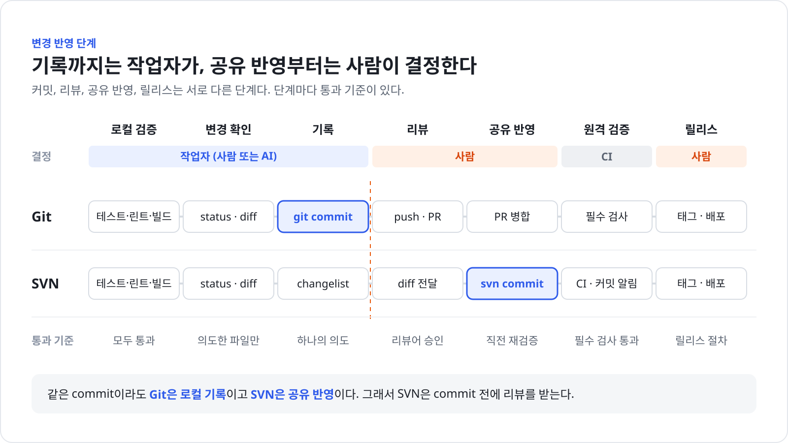

# 개발 가이드

개발 환경을 준비하고, 변경을 검증하고, 저장소에 반영하는 방법을 설명한다. 사람과 AI가 같은 절차를 따른다. AI에게만 해당하는 규칙은 [AGENTS.md](../AGENTS.md)에 있다.

## 준비

- 필요한 도구
  - JDK 21. Gradle은 `backend/gradlew` Wrapper를 쓴다
  - Node.js 22
  - Docker와 Docker Compose v2. 전체 구성 실행, Testcontainers 테스트, E2E 테스트에 필요하다
  - Bash. `scripts/verify`를 실행한다. Windows에서는 Git Bash를 쓴다
- Manager Database: Compose의 `local-db` profile MariaDB, 또는 외부 MariaDB·PostgreSQL
- 환경 변수: `.env.example`을 `.env`로 복사한다. 변수 이름과 예시는 `.env.example`에 있다. Compose로 띄우려면 `SPRING_DATASOURCE_URL`과 `SPRING_DATASOURCE_USERNAME`이 있어야 한다.

```sh
cp .env.example .env

cd infrastructure/secrets
for name in manager_db_password manager_db_root_password app_secret_key \
            telegram_bot_token telegram_webhook_secret alertmanager_webhook_token; do
  cp "$name.example" "$name"
done

cd ../../frontend
npm ci
npm run test:e2e:install
```

`npm run test:e2e:install`은 E2E 테스트용 Chromium을 내려받는다. 처음 한 번, 그리고 `@playwright/test` version이 바뀌었을 때 실행한다. 인터넷 연결이 필요하다.

복사한 secret 파일에는 실제 값을 넣는다.

### 비밀 파일

노출되면 안 되는 값(비밀번호, token, 암호화 key)만 secret으로 둔다. 주소, port, timezone, DB 이름, 계정 이름은 노출돼도 문제가 없으므로 `.env`에 둔다.

`infrastructure/secrets/` 아래 실제 값 파일은 Git에 올리지 않는다. `.gitignore`가 `*.example`만 허용한다. 각 파일이 어느 container의 어떤 property로 들어가는지는 `compose.yml`의 `secrets`가 기준이다.

| 파일 | 쓰는 곳 | container 안 이름 | 용도 |
|---|---|---|---|
| `manager_db_password` | `manager-api`, `manager-db` | `spring.datasource.password` / `manager_db_password` | Manager Database 비밀번호. 두 container가 같은 파일을 쓴다 |
| `manager_db_root_password` | `manager-db` | `manager_db_root_password` | `local-db` profile의 DB 관리자 비밀번호 |
| `app_secret_key` | `manager-api` | `monitoring-manager.secret-key` | 인증 정보를 암호화하는 key. 바꾸면 저장된 값을 읽을 수 없다 |
| `telegram_bot_token` | `manager-api` | `monitoring-manager.telegram.bot-token` | Telegram Bot API 호출 |
| `telegram_webhook_secret` | `manager-api` | `monitoring-manager.telegram.webhook-secret` | Telegram webhook 요청 검증 |
| `alertmanager_webhook_token` | `manager-api`, `alertmanager` | `monitoring-manager.notification.alertmanager-webhook-token` / `alertmanager_webhook_token` | Alertmanager가 Manager webhook을 부를 때 쓰는 Bearer token. 두 container가 같은 파일을 쓴다 |

비밀이 들어가는 방식은 실행 환경마다 다르다.

```text
운영   Docker Secret       container 안 /run/secrets/<target> 파일로 들어간다
개발   환경 변수 fallback   파일이 없으면 .env나 shell 환경 변수 값을 쓴다
```

- `application.yml`의 `spring.config.import: optional:configtree:/run/secrets/`가 `/run/secrets` 아래 파일을 설정값으로 읽는다. 파일 이름이 곧 property 이름이다.
- config tree는 `application.yml`보다 우선한다. 그래서 `APP_SECRET_KEY`처럼 `application.yml`이 받는 환경 변수는 파일이 있으면 파일 값에 진다.
- OS 환경 변수 `SPRING_DATASOURCE_PASSWORD`는 config tree보다 우선한다. 빈 값이라도 넘기면 secret 파일을 덮어쓴다. 그래서 `compose.yml`은 이 변수를 넘기지 않는다.
- Docker 없이 Backend를 띄우면 비밀을 환경 변수(`SPRING_DATASOURCE_PASSWORD`, `APP_SECRET_KEY` 등)로 넣는다.
- Telegram 그룹의 chat id는 secret 파일에 두지 않는다. 알림 대상은 화면에서 등록한다.
- 새 secret은 `infrastructure/secrets/`에 `.example`과 함께 추가하고, `compose.yml`의 `secrets`에 target 이름을 property 이름으로 적는다.

## 명령

| 목적 | 명령 | 언제 쓰는가 |
|---|---|---|
| Frontend 의존성 설치 | `cd frontend && npm ci` | 처음 받았을 때, `package-lock.json`이 바뀌었을 때 |
| 전체 실행 (개발용 DB 포함) | `docker compose --profile local-db up -d --build` | Compose 안의 MariaDB로 전체 구성을 띄울 때 |
| 전체 실행 (외부 DB) | `docker compose up -d --build` | `.env`에 외부 Manager Database를 지정했을 때 |
| Backend 개발 서버 | `cd backend && ./gradlew bootRun` | Backend만 따로 띄울 때. 필요한 환경 변수는 [Backend와 Frontend를 따로 실행](#backend와-frontend를-따로-실행)에 있다 |
| Frontend 개발 서버 | `cd frontend && npm run dev` | 화면을 직접 확인할 때. http://localhost:5173 |
| SNMP 테스트 장비 | `docker compose --profile snmp-test up -d snmp-test-agent` | 개발 환경에서 SNMP 흐름을 확인할 때. 운영에서는 띄우지 않는다 |
| 빠른 검증 | `scripts/verify fast` | 커밋 전. Frontend lint·컴포넌트 테스트·build와 Docker가 필요 없는 Backend 테스트 |
| 전체 검증 | `scripts/verify all` | 공유 반영 전. 빠른 검증의 Frontend 단계, `./gradlew build`, E2E 테스트. Docker와 E2E용 Chromium이 필요하다 |
| 검증 profile 목록 | `scripts/verify list` | 지원하는 profile을 확인할 때 |
| Backend 테스트 | `cd backend && ./gradlew test` | Backend 테스트만 돌릴 때. 종류별 기준은 [TESTING.md](TESTING.md#종류별-기준) |
| Frontend 컴포넌트 테스트 | `cd frontend && npm test` | 화면 코드를 고쳤을 때. Docker가 필요 없다 |
| E2E 테스트 | `cd frontend && npm run test:e2e` | 화면과 API 흐름을 확인할 때. Docker가 필요하다. 첫 실행은 image build 때문에 몇 분 걸린다. 화면을 `127.0.0.1:18081`에 띄우며, 이 port가 이미 쓰이면 환경 변수 `E2E_WEB_PORT`로 바꾼다 |
| E2E용 Chromium 설치 | `cd frontend && npm run test:e2e:install` | 처음 한 번, `@playwright/test` version이 바뀌었을 때 |
| Frontend 린트 | `cd frontend && npm run lint` | 커밋 전. oxlint |
| Frontend 타입 검사·빌드 | `cd frontend && npm run build` | 커밋 전. `tsc -b` 후 `vite build` |
| Backend 빌드 | `cd backend && ./gradlew build` | 빌드 설정이나 의존성을 바꿨을 때. 테스트도 함께 돈다 |
| 문서 검사 | `node scripts/check-docs.mjs` | 문서를 바꿨을 때. 그림을 바꿨다면 `--render`를 붙인다 |

`scripts/verify`는 `frontend/node_modules`가 없으면 멈추고 `npm ci`를 먼저 실행하라고 알린다.

Compose로 띄운 뒤 쓰는 주소는 다음과 같다. 모든 port는 `127.0.0.1`에만 열린다.

| 주소 | 설명 |
|---|---|
| http://localhost:8081 | Monitoring Manager 화면 |
| http://localhost:8080/actuator/health | Backend 상태 |
| http://localhost:9090 | Prometheus |
| http://localhost:9093 | Alertmanager |

### Backend와 Frontend를 따로 실행

```sh
cd backend
SPRING_DATASOURCE_URL=jdbc:mariadb://localhost:13306/monitoring_manager \
SPRING_DATASOURCE_USERNAME=manager \
SPRING_DATASOURCE_PASSWORD=... \
APP_SECRET_KEY=local-dev-secret-key \
./gradlew bootRun

cd frontend
npm run dev
```

개발 서버는 `/api` 요청을 http://localhost:8080 으로 넘긴다. Backend 주소는 `VITE_API_PROXY_TARGET`으로 바꾼다.

### Manager Database 연결

`manager-api`를 지정한 Manager Database에 연결하고 Flyway migration을 적용하는 절차다. 외부 DB를 쓰면 DB 계정을 만들 권한이 필요하다.

1. `.env`가 없으면 `.env.example`을 복사한다.
2. DB 위치에 맞게 `.env`의 `SPRING_DATASOURCE_URL`과 `SPRING_DATASOURCE_USERNAME`을 정한다. MariaDB와 PostgreSQL 예시는 `.env.example`에 있다. URL 안에 비밀번호를 넣지 않는다.
3. 비밀번호를 `infrastructure/secrets/manager_db_password`에 넣는다. Compose 안의 MariaDB를 쓰면 `manager_db_root_password`도 넣는다.
4. Compose 안의 MariaDB를 쓰면 `docker compose --profile local-db up -d --build`, 외부 DB를 쓰면 `docker compose up -d --build`로 실행한다.
5. `curl -s http://localhost:8080/actuator/health`로 Backend 상태를 확인한다.

| 증상 | 확인할 것 |
|---|---|
| `docker compose`가 `SPRING_DATASOURCE_URL이 필요합니다`로 멈춤 | `.env`에 `SPRING_DATASOURCE_URL`과 `SPRING_DATASOURCE_USERNAME`이 있는지 확인한다 |
| 인증 실패로 기동하지 않음 | `manager_db_password` 파일 값과 DB 계정 비밀번호가 같은지 확인한다. compose나 shell에서 `SPRING_DATASOURCE_PASSWORD`를 넘기고 있지 않은지도 확인한다. 환경 변수가 secret 파일을 덮어쓴다 |
| Flyway 또는 schema validate 실패 | 이미 적용된 migration 파일이 바뀌지 않았는지, 두 제품 디렉터리에 같은 version이 있는지 확인한다 |
| host에서 `manager-db`에 붙을 수 없음 | 3306이 아니라 `MANAGER_DB_PORT`(기본 13306)로 접속한다 |

해결할 수 없을 때 연락할 곳은 아직 정하지 않았다. 담당 팀을 정해야 한다.

## 코드 위치

디렉터리별 책임은 [ARCHITECTURE.md의 코드 지도](ARCHITECTURE.md#코드-지도)에 있다.

## 변경 반영 단계



커밋, 공유 반영, 리뷰, 병합, 릴리스는 서로 다른 단계다. 단계마다 통과 기준과 결정하는 사람이 다르다.

| 단계 | 하는 일 | 통과 기준 | 결정 |
|---|---|---|---|
| 로컬 검증 | 관련 테스트, 린트, 빌드 실행 | 모두 통과 | 작업자 |
| 변경 확인 | diff와 VCS 상태 확인 | 의도한 파일만 바뀜, 문서 갱신 | 작업자 |
| 기록 | 하나의 의도로 변경을 묶고 메시지 작성 | [커밋](#커밋) 규칙 | 작업자 |
| 리뷰 | 다른 사람이 변경을 검토 | 리뷰어 승인 | 사람 |
| 공유 반영 | 공유 저장소에 올림 | 리뷰 승인, 반영 직전 재검증 | 사람 |
| 원격 검증 | CI가 같은 검사를 다시 실행 | CI 없음. 공유 반영 직전에 로컬에서 `scripts/verify all` | 사람 |
| 릴리스 | 버전 표시와 배포 | 릴리스 절차. 아직 정하지 않았다 | 사람 |

작업자는 사람일 수도 있고 AI일 수도 있다. AI는 사람이 지시할 때만 리뷰 요청, 공유 반영, 병합, 릴리스를 한다.

### Git

| 단계 | 명령 |
|---|---|
| 최신 코드 받기 | `git pull --rebase` |
| 변경 확인 | `git status`, `git diff`, `git diff --check` |
| 기록 | `git add -p`, `git commit` |
| 리뷰 요청 | 작업 브랜치를 push하고 PR(merge request)을 연다 |
| 공유 반영 | 리뷰 승인과 필수 검사 통과 후 병합한다 |

- 작업 브랜치 이름 규칙은 아직 정하지 않았다. 원격 저장소를 정할 때 함께 정해야 한다.
- 기본 브랜치(`main`)에 직접 push하지 않는다.
- PR 설명은 PR 템플릿이 있으면 그 형식을, 없으면 [AGENTS.md의 결과 보고](../AGENTS.md#결과-보고) 형식을 쓴다.
- 저장소 설정에서 기본 브랜치를 보호한다. 리뷰 승인 1명 이상, 필수 검사 통과, 강제 push 금지를 켠다.

## 커밋

요약은 [Conventional Commits](https://www.conventionalcommits.org/ko/v1.0.0/) 형식(`종류: 설명`)으로 쓴다. 메시지는 요약 한 줄, 빈 줄, 본문, 빈 줄, 꼬리말 순서다.

```text
fix: 로그인 실패 시 오류 메시지 표시

비밀번호가 틀려도 화면에 아무 변화가 없어 사용자가 같은 값을 계속 입력했다.
서버가 401을 돌려주면 입력란 아래에 원인과 다시 시도하는 방법을 보여준다.

Refs: #123
```

| 종류 | 쓰는 때 |
|---|---|
| `feat` | 사용자가 쓰는 기능을 추가하거나 바꿀 때 |
| `fix` | 버그를 고칠 때 |
| `docs` | 문서만 바꿀 때 |
| `refactor` | 동작을 바꾸지 않고 코드 구조를 바꿀 때 |
| `test` | 테스트만 추가하거나 고칠 때 |
| `perf` | 성능을 개선할 때 |
| `build` | 빌드 설정이나 의존성을 바꿀 때 |
| `ci` | CI 설정을 바꿀 때 |
| `chore` | 그 밖의 관리 작업 |

- 종류는 영어 소문자로 쓴다. 바뀌는 범위가 분명하면 괄호로 붙인다. 예: `fix(auth): 만료 토큰 갱신 실패 처리`
- 설명은 무엇을 바꿨는지 한국어로 50자 안팎으로 쓰고 명사형으로 끝낸다. 마침표를 찍지 않는다.
- "수정", "버그 수정", "작업"처럼 무엇이 바뀌었는지 알 수 없는 설명은 쓰지 않는다.
- 호환성을 깨는 변경은 종류 뒤에 `!`를 붙이고 본문에 `BREAKING CHANGE: 무엇이 깨지는가`를 쓴다.
- 본문에는 diff만 봐서는 알 수 없는 이유와 영향을 쓴다. 코드를 다시 설명하지 않는다.
- 꼬리말 키는 영어로 쓴다. 예: `Refs: #123`, `Fixes #123`, `Co-authored-by: 이름 <메일>`
- 하나의 커밋에는 하나의 의도만 담는다. 리팩터링과 동작 변경은 나눈다.
- 커밋마다 빌드와 테스트가 통과해야 한다.
- 변경이 수백 줄을 넘으면 나눌 수 있는지 먼저 검토한다. 생성된 코드와 기계적인 이름 변경은 예외다.
