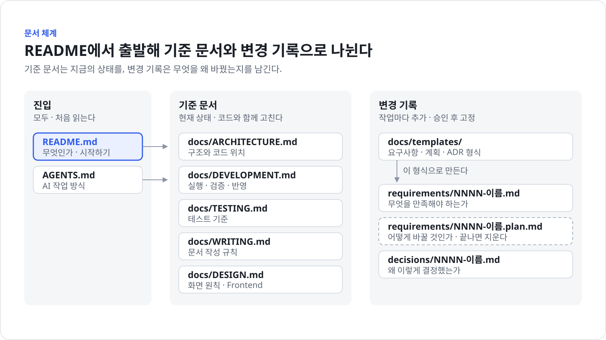

# 문서 작성 가이드

이 저장소의 문서를 어디에, 어떤 형식과 문장으로, 어떤 그림과 함께 쓰는지 정한다. 문서나 그림을 만들거나 고치기 전에 읽는다.

## 문서 체계



| 문서 | 답하는 질문 | 고치는 때 |
|---|---|---|
| `README.md` | 무엇인가, 어떻게 시작하는가, 어떤 문서가 있는가 | 목적, 시작 방법, 문서 구성이 바뀔 때 |
| `AGENTS.md` | AI는 어떻게 일하는가 | 작업 절차나 AI가 반복하는 실수가 생길 때 |
| `docs/ARCHITECTURE.md` | 시스템은 어떻게 나뉘고 어디를 고쳐야 하는가 | 실행 단위, 디렉터리 책임, 경계가 바뀔 때 |
| `docs/architecture/*.md` | Check, SNMP, 알림은 어떻게 동작하고 어떻게 운영하는가 | 해당 영역의 동작이나 운영 절차가 바뀔 때 |
| `docs/DEVELOPMENT.md` | 어떻게 실행하고 검증하고 반영하는가 | 도구, 명령, 브랜치·커밋 규칙이 바뀔 때 |
| `docs/TESTING.md` | 무엇을 어떤 테스트로 검증하는가 | 테스트 종류, 명령, 기준이 바뀔 때 |
| `docs/DESIGN.md` | 화면은 어떤 원칙으로 만드는가 | 사용자, 시각 방향, 디자인 토큰, UI 패턴이 바뀔 때 |
| `docs/WRITING.md` | 문서는 어떻게 쓰는가 | 문서 규칙이 바뀔 때 |
| `docs/requirements/NNNN-이름.md` | 이 기능은 무엇을 만족해야 하는가 | 기능을 추가하거나 동작을 바꿀 때 |
| `docs/requirements/NNNN-이름.plan.md` | 이 기능을 어떻게 바꿀 것인가 | 큰 변경을 하는 동안. 끝나면 지운다 |
| `docs/decisions/NNNN-이름.md` | 왜 이렇게 결정했는가 | 되돌리기 어려운 결정을 할 때. 승인 후에는 고치지 않고 새 ADR로 대체한다 |
| `docs/templates/` | 요구사항, 계획, ADR은 어떤 형식인가 | 형식을 바꾸기로 합의했을 때 |
| `docs/assets/` | 문서에 들어가는 그림 | 그림을 쓰는 문서를 고칠 때 |

### 출처는 한 곳

- 같은 정보는 한 문서에만 쓴다. 다른 문서에서는 한 줄로 요약하고 링크한다.
- 명령은 `DEVELOPMENT.md`, 테스트 기준은 `TESTING.md`, 구조는 `ARCHITECTURE.md`가 기준이다. README와 AGENTS.md는 이들을 요약한다.
- 코드를 바꾸면 같은 변경에서 관련 문서도 고친다.

### 새 문서를 만드는 기준

위 표에 있는 문서로 먼저 해결한다. 새 문서는 다음 가운데 하나 이상이 성립하고 기존 문서에 넣으면 목적이 흐려질 때만 만든다.

- 독자가 다르다.
- 읽는 시점이 다르다.
- 바뀌는 주기가 다르다.
- 따로 링크할 가치가 있다.

길다는 이유만으로 나누지 않는다. 반대로 같은 질문에 답하는 짧은 문서가 여러 개면 합친다.

새 Markdown 파일을 만들기 전에 다음을 확인한다. 하나라도 "아니요"면 만들지 않는다.

1. 기존 문서에 추가할 수 없는가?
2. 코드나 설정이 원본이 아닌가?
3. 오래 유지할 내용인가?
4. 한 번 쓰고 버릴 분석이 아닌가?

`ARCHITECTURE.md`는 하위 시스템이 따로 배포되거나 기술 스택이 다르고, 코드 지도가 한 화면을 넘을 때 `docs/architecture/하위-시스템.md`로 나눈다. 이때도 전체 구조, 실행 단위, 공통 경계는 `ARCHITECTURE.md`에 남긴다.

### 만들지 않는 문서

다음 문서는 저장소에 남기지 않는다. 필요한 내용은 위 표의 문서, 커밋 메시지, 리뷰 대화로 옮긴다.

- 작업 보고서, 세션 요약, 인수인계 메모, 리뷰 기록
- 내용 없이 다른 문서 링크만 모은 문서
- 빈 자리표시자 문서, 쓰지 않는 템플릿 사본
- 도구 적용 기록이나 버전 기록처럼 개발에 쓰이지 않는 관리 문서

## 내용

### 확인한 사실만 쓴다

- 코드, 테스트, 설정, schema, 기존 문서에서 확인한 내용만 사실로 쓴다.
- 근거가 없는 목적, 설계 의도, 장점, 미래 계획을 추측해 쓰지 않는다. 확인하지 못한 내용을 사실처럼 채우지 않는다.
- 기존 문서를 고칠 때는 관련 코드와 설정이 문서와 여전히 맞는지 확인한다. 확인하지 못했으면 최신이라고 쓰지 않는다.

### 원본을 복제하지 않는다

코드나 설정에서 바로 확인할 수 있는 정보는 다시 나열하지 않고 원본 위치를 연결한다.

- 전체 API 목록, 전체 DB schema, 전체 class·함수 목록
- 전체 dependency 목록, 전체 환경 변수 목록
- 코드에서 그대로 재구성할 수 있는 호출 관계

### 오래 가치가 있는 내용만 남긴다

영구 문서에는 프로젝트의 목적, 코드만으로 알기 어려운 제약, 중요한 결정과 이유, trade-off, 자동화되지 않은 운영 절차를 둔다. 일회성 코드 분석이나 특정 기능의 현재 구현 설명을 영구 문서로 만들지 않는다.

### ADR은 규칙집이 아니다

ADR에는 중요한 기술 결정의 배경, 결정, 결과와 trade-off를 쓴다. 일반 코딩 규칙이나 반복 작업 절차를 ADR로 만들지 않는다.

### 근거 없는 수식어를 쓰지 않는다

`효율적인`, `강력한`, `유연한`, `확장 가능한`, `원활한`, `다양한`, `최적의` 같은 수식어는 구체적인 근거와 함께만 쓴다. 한 문단에는 한 주제만 쓰고, 핵심을 먼저 쓴다. 서론과 반복 결론을 쓰지 않고, 같은 내용을 제목·본문·요약에서 되풀이하지 않는다.

## 한국어

문서는 평서형(`-다`)으로 쓴다. 목록과 표의 항목은 명사형이나 짧은 문장으로 끝낸다. 한 문서에서 `-습니다`와 `-다`를 섞지 않는다.

| 규칙 | 이렇게 쓰지 않는다 | 이렇게 쓴다 |
|---|---|---|
| 한 문장에 한 가지 내용 | 토큰을 확인하고 만료됐으면 갱신하며 실패하면 로그인 화면으로 보내야 한다 | 토큰이 만료됐으면 갱신한다. 갱신에 실패하면 로그인 화면으로 보낸다 |
| 주어와 동작을 분명하게 | 설정이 완료되어야 실행이 가능하다 | 설정을 마친 뒤 실행한다 |
| 이중 피동 금지 | 값이 저장되어진다, 보여진다 | 값을 저장한다, 보인다 |
| 빈 동사 대신 실제 동작 | 배포를 진행한다, 검증을 수행한다 | 배포한다, 검증한다 |
| 번역투 줄이기 | API를 통해 조회한다 | API로 조회한다 |
| 번역투 줄이기 | 배포 절차에 대해 설명한다 | 배포 절차를 설명한다 |
| 번역투 줄이기 | 테스트에 있어서 중요한 점 | 테스트에서 중요한 점 |
| 번역투 줄이기 | 세 개의 모듈을 가지고 있다 | 모듈이 세 개 있다 |
| 직접 서술 | 이 값은 캐시 키로 사용되는 것이다 | 이 값은 캐시 키로 쓴다 |
| 모호한 표현 금지 | 적절한 크기로 나눈다, 일부 브라우저에서 문제가 있을 수 있다 | 300줄 안팎으로 나눈다, Safari 16에서 날짜 입력이 비어 보인다 |
| 군더더기 금지 | 앞서 설명했듯이, 참고로 말하자면 | 바로 본론을 쓴다 |

### 용어

- 코드, 명령, 파일 이름, 설정 키, 제품 이름은 원문 그대로 쓰고 코드 서식으로 표시한다. 예: `git commit`, `main`, `.env`
- 개발 현장에서 굳어진 외래어는 한글로 쓴다. 예: 커밋, 브랜치, 테스트, 배포, 리뷰, 빌드
- 한글로 옮기면 뜻이 흐려지는 용어는 영어로 쓴다. 예: diff, PR, CI, API, E2E, worktree
- 처음 나오는 약어는 풀어 쓴다. 예: ADR(Architecture Decision Record)
- 한 개념에는 한 용어만 쓴다. 이 저장소에서 정한 용어는 다음과 같다.

| 쓰는 말 | 쓰지 않는 말 |
|---|---|
| 요구사항 | 요건, 스펙, 명세(문서 이름으로) |
| 공유 반영 | 업로드, 올리기, 반영(뜻이 모호할 때) |
| 자체 리뷰 | 셀프 체크, 자가 검토 |
| 허용 목록, 차단 목록 | 화이트리스트, 블랙리스트 |

### 제목

- 명사형으로 쓰고 30자를 넘기지 않는다. 예: `변경 반영 단계`, `버그 수정과 회귀 테스트`
- 물음표와 느낌표를 쓰지 않는다.
- 제목만 읽어도 내용을 짐작할 수 있게 핵심 단어를 넣는다. `기타`, `참고`, `상세`, `추가 내용`처럼 무엇이 있는지 알 수 없는 제목을 쓰지 않는다.

## 형식

- 다른 문서나 절을 가리킬 때는 문서 이름과 제목으로 링크한다. 예: `[DEVELOPMENT.md의 커밋](DEVELOPMENT.md#커밋)`
- `3장`, `다음 절`, `위에서 설명한`처럼 위치나 번호에 기대는 표현을 쓰지 않는다. 문서가 바뀌면 의미가 사라진다.
- 링크 문구는 대상을 설명한다. "여기", "이 문서"를 링크 문구로 쓰지 않는다.
- 순서가 있는 절차는 번호 목록, 순서가 없는 항목은 글머리표 목록으로 쓴다. 항목이 하나뿐이면 목록으로 만들지 않는다.
- 세 가지 이상 속성을 비교하면 표로 쓴다.
- 단순한 문장을 억지로 목록이나 표로 바꾸지 않는다.
- 제목은 `####`까지 내려가지 않게 구성한다. 필요해 보이면 문서를 나눌지 검토한다.
- 날짜는 `2026-01-31` 형식으로 쓴다. "최근", "현재", "곧"처럼 시간이 지나면 틀리는 말을 쓰지 않는다.
- 아직 정하지 않은 내용은 `아직 정하지 않았다.`라고 쓰고 무엇을 정해야 하는지 덧붙인다. 빈 절, `TBD`, 추측한 값을 남기지 않는다.
- 비밀값, 개인정보, 개인 PC 경로를 쓰지 않는다.

## 그림

### 그림을 넣는 기준

글로 설명하면 이해가 느리고, 관계·순서·구조를 그림으로 보면 더 빨리 이해되는 곳에 그림을 넣는다. 예를 들면 작업 흐름, 시스템 경계, 데이터 흐름, 사용자 흐름, 상태 전이, 테스트 범위, 변경 전후 비교다. 문장 몇 줄로 충분하면 그리지 않는다.

### 형식

- 그림은 SVG 파일로 `docs/assets/`에 두고, 그림을 설명하는 문서에서 ``로 넣는다. 대체 텍스트에는 그림이 전달하는 핵심을 한 문장으로 쓴다.
- SVG는 직접 작성한 코드로 관리한다. Git과 SVN에서 diff로 리뷰할 수 있고, 별도 도구 없이 어느 저장소 화면에서나 같은 모습으로 보인다.
- 새 그림은 `docs/assets/`에 있는 기존 그림의 `<style>` 블록을 복사해서 시작한다. 같은 저장소의 그림은 같은 색, 글꼴, 크기를 쓴다.
- 문서 어디에서도 쓰지 않는 그림은 지운다.
- Mermaid는 PR이나 이슈 댓글처럼 잠깐 쓰는 설명에만 쓴다. SVN 저장소 화면과 일부 도구가 렌더링하지 못하고, 모양을 세밀하게 다듬을 수 없다.

### 디자인 규칙

에디토리얼 정보 그래픽을 목표로 한다. 장식보다 정보 구조와 가독성을 먼저 본다.

- **캔버스**: 폭 1600px. 발표 자료에 쓸 그림은 1600×900(16:9)으로 그린다. 바깥 여백은 64px.
- **격자**: 좌표와 간격은 8의 배수로 맞춘다. 같은 종류의 요소는 같은 선에 정렬한다.
- **글자**: 최소 22px. 제목 40px 굵게, 본문 24~28px, 보조 설명 22px. 글자 크기는 세 단계, 굵기는 두 단계를 넘기지 않는다. 글자를 회전하지 않는다.
- **글꼴**: `Pretendard, "Apple SD Gothic Neo", "Malgun Gothic", "Noto Sans KR", sans-serif`. 외부 웹 폰트는 불러오지 않는다. 문서 화면에서 SVG는 외부 리소스를 읽지 못한다. 글꼴마다 글자 폭이 10% 안팎 다르므로 상자 안에 여유를 둔다.
- **색**: 의미가 정해진 색만 쓴다. 한 그림에 강조색은 두 가지까지다.

| 역할 | 색 | 쓰는 곳 |
|---|---|---|
| 본문 | `#1B1F27` | 제목, 노드 이름 |
| 보조 | `#5B6472` | 설명, 주석 |
| 약한 선 | `#D7DCE3` | 연결선, 구분선, 테두리 |
| 바탕 | `#F4F6F8` | 묶음 영역 |
| 주요 | `#2F5BEA` | 이 그림의 주인공, AI가 하는 일, 주 흐름 |
| 사람 결정 | `#E8590C` | 사람이 승인하거나 결정하는 지점, 위험 |

- **연결선**: 꺾은선(직교)으로 그리고 한 선에 꺾임은 두 번까지. 선끼리 교차하지 않게 배치한다. 화살표 방향은 한 그림 안에서 왼쪽→오른쪽 또는 위→아래 하나로 통일한다. 선 위에 글자를 올리지 않는다.
- **묶음**: 관련 요소는 바탕색 영역이나 간격으로 묶는다. 테두리를 겹겹이 두르지 않는다.
- **장식 금지**: 그림자, 그라디언트, 3D, 의미 없는 아이콘을 쓰지 않는다.
- **메시지**: 그림 맨 위 제목에는 주제가 아니라 그림의 결론을 문장으로 쓴다. 예: "시스템 구성"이 아니라 "모든 요청은 API 서버를 거쳐 DB에 닿는다".
- **배경**: 흰 바탕에 옅은 테두리와 둥근 모서리를 둔다. 어두운 테마 화면에서도 카드처럼 읽힌다.

### SVG 작성 규칙

- 루트에 `viewBox`, `role="img"`, `<title>`, `<desc>`를 넣는다.
- `<script>`, `foreignObject`, 외부 URL을 쓰지 않는다.
- 노드는 `<g class="node">` 안에 도형을 먼저 두고 글자를 넣는다. 연결선에는 `class="edge"`를 붙인다. 렌더링 검사가 이 표시로 글자 넘침과 선 겹침을 찾는다.
- 그리는 순서는 배경, 묶음 바탕, 연결선, 노드다. 연결선을 묶음 바탕보다 먼저 그리면 바탕에 가려진다.
- 요소 묶음마다 `<g id="...">`와 짧은 주석을 달아 diff에서 어느 부분이 바뀌었는지 알 수 있게 한다.

### 렌더링 확인

그림을 만들거나 고치면 소스만 보고 끝내지 않는다.

```sh
node scripts/check-docs.mjs --render
```

이 명령은 Chrome이나 Edge로 그림을 렌더링해서 글자 잘림, 바깥 여백 침범, 글자 겹침, 상자 밖으로 넘친 글자, 글자 위를 지나는 선, 바탕에 가려진 선, 노드 겹침을 찾고 PNG를 남긴다. Pretendard가 없는 PC를 대신해 `--font "Malgun Gothic"`으로도 한 번 더 실행한다. 검사를 통과한 뒤에도 PNG를 직접 열어 다음을 확인한다.

- 본문 폭(약 880px)으로 줄여 봐도 글자를 읽을 수 있다.
- 여백이 고르고 요소가 격자에 맞게 정렬돼 있다.
- 첫눈에 결론이 보이고, 시선이 한 방향으로 흐른다.

PNG는 확인용이다. 저장소에 넣지 않는다.
